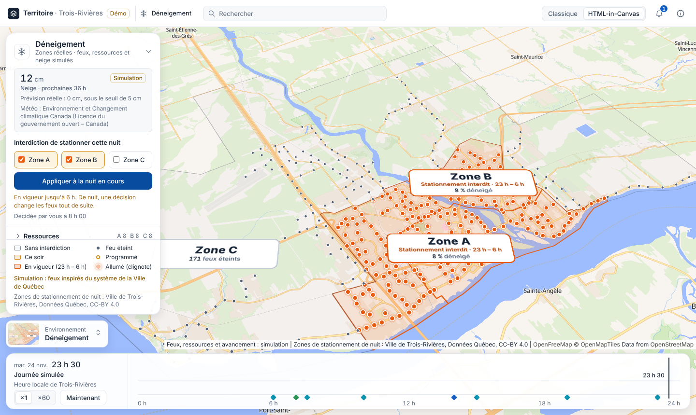

# Territoire · Trois-Rivières : gestion du territoire en 3D avec HTML-in-Canvas

> **Démo non officielle.** Ni la Ville de Trois-Rivières ni aucune autre municipalité n'a
> produit, vérifié ou approuvé cette démo. Elle combine des données ouvertes réelles et des
> données simulées, toujours marquées « Simulation » ou « simulé ».

Un outil de gestion du territoire municipal, côté administration : une même scène 3D de
Trois-Rivières où chaque service de la ville est un **environnement**. Le gestionnaire voit les
alertes en arrivant, entre dans un environnement, fait une opération (isoler un bris, décréter une
interdiction de stationner), puis passe à un autre environnement sans que la carte se recharge.

C'est surtout une démonstration de l'API expérimentale **HTML-in-Canvas** (Chrome/Edge) dans un
vrai contexte de gestion : du vrai HTML (boutons, focus clavier, noms pour les lecteurs d'écran)
dessiné **dans** la scène WebGL, posé au sol, masqué par les bâtiments, et présent dans les vidéos
exportées. Sans l'API, tout reste utilisable en mode classique (étiquettes DOM plates).



Bilan des possibilités, environnement par environnement : **[CAPABILITIES.md](CAPABILITIES.md)**.
Règles d'emploi de l'API : **[RULES.md](RULES.md)**. Vidéo de la visite (14 s, accueil → Aqueduc →
Déneigement) : [`public/territoire/visite-hic.webm`](public/territoire/visite-hic.webm).

## Pages

| URL | Page |
|---|---|
| `/` | Accueil : alertes actives, météo réelle, prochains événements, les cinq environnements |
| `/carte/aqueduc` | Vue 3D de l'environnement Aqueduc |
| `/carte/deneigement` | Vue 3D de l'environnement Déneigement |
| `/a-propos` | Démo non officielle, sources et licences, réel et simulé, crédits |
| `/bench` | Banc de mesures classique vs HTML-in-Canvas (lien discret depuis « À propos ») |

Les vues `/carte/*` partagent une seule scène MapLibre : le sélecteur d'environnement (en bas à
gauche) fait voler la caméra, remplace les couches et les inscriptions, et met l'URL à jour, sans
recharger la carte. Le mode se force par `?mode=classic` ou `?mode=hic`.

## Les cinq environnements

| Environnement | Lot | Ce qu'on y fait | Réel | Simulé |
|---|---|---|---|---|
| **Aqueduc** | 1 | Pressions, qualité, âge, rinçage ; scénario guidé du bris de 14 h (coupe sous la rue, vannes à fermer) ; vue souterraine | Tracé des 24 137 conduites | Capteurs, mesures, secteurs, adresses, débits, bris |
| **Déneigement** | 1 | Décider l'interdiction de stationner de la nuit par zone (cocher, décider) ; assigner des ressources ; suivre l'avancement | Les 3 zones de stationnement de nuit ; la prévision d'ECCC quand elle annonce de la neige | Feux d'interdiction (inspirés du système de la Ville de Québec), ressources, avancement, neige quand la prévision réelle n'en annonce pas assez |
| **Collecte** | 2 | **À venir** | | |
| **Zonage** | 2 | **À venir** | | |
| **Évaluation foncière** | 2 | **À venir** | | |

Collecte, Zonage et Évaluation forment le lot 2 : ils figurent à l'accueil et dans le sélecteur,
marqués « À venir » et inactifs (`/carte/collecte` ramène à l'accueil).

**Horloge commune.** Toute la ville suit une horloge simulée, en heure de Trois-Rivières. Elle part
de la date et de l'heure réelles, et chaque jour rejoue la même journée scénarisée : prévision de
neige à 7 h 30, décision par défaut de la direction à 10 h si le visiteur n'a pas décidé, bris de
conduite à 14 h, heure conseillée pour décider à 15 h (plus tard, la décision reste possible, avec
une mise en garde), interdiction en vigueur de 23 h à 6 h. La frise de 24 h permet d'aller à
n'importe quelle heure ; les alertes et les états suivent. La date fixe du 24 novembre 2026
(`SCENARIO_DAY`) ne fixe que les tests, le banc et les preuves ; le serveur s'en sert aussi comme
jour de référence pour les chiffres du rapport du bris, les mêmes chaque jour.

Chaque visiteur a son propre état (décisions, scénario), en mémoire dans son onglet, sans base de
données : ce qu'un visiteur décide n'apparaît pas chez les autres.

## Lancer

```bash
npm install
```

```bash
npm run dev
```

Ouvrir <http://localhost:3000/> : HTML-in-Canvas si le navigateur l'active, sinon mode classique.
Aucune base de données ni clé n'est nécessaire. Les conduites, les zones et les feux simulés sont
versionnés dans `data/`. Le serveur appelle en direct la météo d'Environnement Canada ; le
navigateur charge les tuiles OpenFreeMap. Sans JavaScript, l'accueil et chaque vue 3D affichent un
résumé rendu par le serveur.

Sans l'API, la vue reste en mode classique et un bandeau propose « Voir la version HTML-in-Canvas
en vidéo » (la vidéo de la visite) et « Comment l'activer ».

## Données et licences

| Données | Éditeur | Licence | Utilisation | Provenance |
|---|---|---|---|---|
| Conduites d'eau potable | Ville de Trois-Rivières | CC-BY 4.0 | Tracé des conduites (Aqueduc) ; emplacements des feux simulés | [Données Québec](https://www.donneesquebec.ca/recherche/dataset/7ad4ea4e-cfc5-417b-9eb8-6e7f379a8f6e), extrait le 24 nov. 2026 : [data/aqueduc/SOURCE.md](data/aqueduc/SOURCE.md) |
| Stationnement de nuit | Ville de Trois-Rivières | CC-BY 4.0 | Zones A, B et C (Déneigement) | [Données Québec](https://www.donneesquebec.ca/recherche/dataset/63037f5c-f592-4538-89b2-8a850e758b97), extrait le 25 nov. 2026 : [data/territoire/SOURCE.md](data/territoire/SOURCE.md) |
| Météo de la ville (citypageweather) | Environnement et Changement climatique Canada | [Licence du gouvernement ouvert – Canada](https://ouvert.canada.ca/fr/licence-du-gouvernement-ouvert-canada) | Conditions, prévision et neige des 36 h à venir (accueil, Déneigement) | [API GéoMet](https://api.weather.gc.ca/collections/citypageweather-realtime), appelée en direct par le serveur, **sans clé API**, cache de 30 min (un échec est gardé 90 s, les appels simultanés partagent une requête) ; en cas de panne, la dernière prévision reçue, marquée comme telle, sinon « Météo indisponible » et la neige simulée |
| Fond de carte (style « liberty ») | OpenFreeMap, OpenMapTiles, contributeurs OpenStreetMap | ODbL (données OSM) | Rues, bâtiments 3D, noms de lieux | [openfreemap.org](https://openfreemap.org) |

L'attribution est affichée partout où les données apparaissent : contrôle d'attribution de la
carte, légende et fiche du Déneigement, carte météo, « À propos », et le bandeau de crédits des
vidéos exportées (le contrôle de MapLibre est du DOM, absent du canvas enregistré) :

- « Conduites : Ville de Trois-Rivières, Données Québec, CC-BY 4.0 » ;
- « Zones de stationnement de nuit : Ville de Trois-Rivières, Données Québec, CC-BY 4.0 » ;
- « Météo : Environnement et Changement climatique Canada (Licence du gouvernement ouvert – Canada) » ;
- « Fond de carte : OpenFreeMap / OpenMapTiles / OpenStreetMap ».

Les conditions d'OpenFreeMap autorisent l'intégration gratuite mais interdisent la collecte
automatisée : le banc, les preuves et les vignettes chargent la carte quelques dizaines de fois,
pas plus (profil Chromium avec cache HTTP).

**Ce qui est simulé.** Dans l'Aqueduc : capteurs, mesures, secteurs, adresses desservies, débits,
vannes et le bris de conduite. Dans le Déneigement : les feux d'interdiction (Trois-Rivières n'en a
pas à notre connaissance), leurs emplacements, les ressources, l'avancement, la décision par
défaut de la direction et la neige de la journée scénarisée quand la prévision réelle n'en
annonce pas. Pour toute la ville : l'horloge et le déroulé de la journée scénarisée, rejoué chaque jour.

## Commandes

Le banc, les preuves et les vignettes visent un serveur de production ; `BASE_URL` vaut
`http://localhost:3300` par défaut :

```bash
npm run build
```

```bash
npx next start -p 3300
```

| Commande | Effet |
|---|---|
| `npm run territoire:data` | Retélécharge les zones de stationnement de nuit, régénère les feux simulés et réécrit `data/territoire/` (dont `SOURCE.md`). Inutile pour lancer la démo. |
| `npm run aqueduc:data` | Retélécharge les conduites et réécrit `data/aqueduc/trois-rivieres.json` et `SOURCE.md` (la section des seuils est conservée). Inutile pour lancer la démo. |
| `npm run thumbs:territoire` | Régénère les cinq vignettes de l'accueil (`public/territoire/mini-*.webp`), vraies captures de la scène. |
| `npm run proofs:territoire` | Régénère les preuves : `docs/territoire/` (accueil, Aqueduc, Déneigement à 23 h 30, fiche de zone, passage d'un environnement à l'autre, sans l'API, images de la vidéo, `proofs.json`), la vidéo de la visite `public/territoire/visite-hic.webm`, et les preuves détaillées de l'Aqueduc dans `docs/aqueduc/`. Environ 3 min ; demande `ffmpeg` et `ffprobe`. `ONLY=territoire` ou `ONLY=aqueduc` pour une seule série. `proofs:aqueduc` en est l'alias. |
| `npm run bench:aqueduc` | Banc classique vs HTML-in-Canvas de l'environnement Aqueduc (20, 60, 120 étiquettes ; rotation, caméra immobile, scénario ; vue souterraine). Écrit `bench/results/aqueduc.csv` et `aqueduc-meta.json`, affichés sur `/bench`. Environ 12 min. Variables : `REPEAT`, `TAGS`, `MODES`, `SCALE`, `UNDERGROUND=0`. |
| `npm run bench:aqueduc -- --quick` | Essai rapide du banc (une configuration par mode, phases courtes, environ 40 s) ; écrit dans le dossier temporaire du système, jamais dans `bench/results/`. |

Derrière un proxy TLS, les scripts de données ont besoin de `NODE_EXTRA_CA_CERTS`.

## Tests et vérification

Tests unitaires (journée et horloge, alertes, déneigement, météo, navigation, simulation et
graphe de l'aqueduc, géométrie, export vidéo…) et vérification des types :

```bash
npm test
```

```bash
npm run typecheck
```

Vérification de bout en bout (Chromium de Playwright) contre un serveur de production : accueil
avec et sans JavaScript, cloche des alertes, « À propos », changement d'environnement sans
rechargement, Déneigement (décision, feux, fiche, nuit), panne de la météo, deux modes, vue
souterraine, scénario, 390 px, bandeau sans l'API, repli, `/bench` :

```bash
BASE_URL=http://localhost:3300 npx tsx tests/e2e/smoke.ts
```

Variables facultatives de captures (`SHOT_HOME`, `SHOT_DN_2330`, `SHOT_NOAPI`…) : voir l'en-tête
de `tests/e2e/smoke.ts`.

## Activer l'API

| Navigateur | Comment |
|---|---|
| Chrome Canary / Dev | `chrome://flags/#canvas-draw-element` → *Enabled*, relancer |
| Ligne de commande (Playwright, CI) | `--enable-blink-features=CanvasDrawElement` |
| Simuler un Chrome **sans** l'API | `--disable-blink-features=CanvasDrawElement` |
| Production | jeton d'Origin Trial : variable d'environnement `HIC_ORIGIN_TRIAL_TOKEN` |

**Jeton d'Origin Trial.** Si `HIC_ORIGIN_TRIAL_TOKEN` est définie à l'exécution, le layout ajoute
`<meta http-equiv="origin-trial" content="…">` à toutes les pages (`src/lib/origin-trial.ts`) ;
sans jeton, rien ne change. Le jeton est lié au domaine d'hébergement : en demander un pour ce
domaine, puis par exemple `docker run -e HIC_ORIGIN_TRIAL_TOKEN=… …` (en local : copier
`.env.example` en `.env`). Aucun jeton n'est fourni ici, et aucune clé ni aucun secret n'est
versionné : toute clé future passera par une variable d'environnement lue côté serveur.

Constat : le Chromium 158 fourni avec Playwright 1.63 expose déjà l'API **sans flag** ;
`--disable-blink-features=CanvasDrawElement` la retire bien. Le banc et les preuves passent tout
de même `--enable-blink-features=CanvasDrawElement` pour rester valables sur les versions où elle
est désactivée par défaut.

Testez sur `localhost`, jamais dans un iframe sandboxé : l'API peut y être détectée sans
transmettre aucun pixel (texture noire). La démo le détecte (lecture de texels après upload) et
bascule en mode classique avec la raison affichée.

## Docker / Coolify

```bash
docker build -t territoire-3d .
```

```bash
docker run -p 3000:3000 territoire-3d
```

Ou, avec le même `Dockerfile` :

```bash
docker compose up --build
```

Image `node:22-alpine`, build standalone, utilisateur non root, `HEALTHCHECK` sur
`/api/aqueduc/series`. Les données versionnées, les résultats du banc, les vignettes et la vidéo
de `public/territoire/` y sont inclus. Le conteneur doit pouvoir joindre `api.weather.gc.ca` en
HTTPS pour la météo (sinon « Météo indisponible »). Seule variable, facultative :
`HIC_ORIGIN_TRIAL_TOKEN`. Sur Coolify : déployer le `Dockerfile` et renseigner le jeton si besoin.

## Architecture

- **Routes** (Next.js 16, App Router) : l'accueil `src/app/page.tsx` ; la scène persistante dans
  `src/app/carte/layout.tsx`, qui survit à la navigation entre `/carte/[env]` ; les API
  `src/app/api/aqueduc/*` (réseau, série, flux SSE des capteurs) et `src/app/api/territoire/*`
  (zones et feux, météo).
- **Environnements** (`src/client/territoire/modules/`) : chaque module apporte son cadrage, ses
  couches, ses surfaces HTML-in-Canvas, son panneau, sa fiche et son attribution ; il est monté à
  l'arrivée et démonté sans fuite au départ. Horloge, actions du visiteur et alertes sont communes
  (`src/client/territoire/store.ts`, `src/lib/territoire/`).
- **HTML-in-Canvas** (`src/client/hic3d/`) : les inscriptions sont de vrais éléments React montés
  dans le canvas de MapLibre (`content="drawable"`), capturés dans le handler `paint`
  (`texElementSubImage2D`, en **restaurant l'état GL** que MapLibre garde en cache) et dessinés
  par une custom layer en `renderingMode: "3d"` qui partage le **tampon de profondeur** des
  bâtiments. `updateElementGeometry` reçoit une matrice projective 4×4 : le hit testing suit la
  perspective ; des requêtes d'occlusion WebGL2 le complètent (voir CAPABILITIES.md).
- **Pièges** : dans la custom layer, la matrice à utiliser est
  `defaultProjectionData.mainMatrix` ; le worker de MapLibre 6 est servi tel quel par
  `/maplibre/[file]` (`setWorkerUrl`), Turbopack le réécrivait et relançait le rechargement à
  chaud en boucle.

## Limites connues de l'API (constatées sur Chromium 158)

Détails et mesures dans [RULES.md](RULES.md#pièges-et-écarts-entre-la-documentation-et-le-comportement-réel).

- `captureElementImage()` renvoie un `ElementImage` qui **n'expose pas sa taille** (seulement
  `close()`) : il faut la calculer (`offsetWidth × canvas.width / canvas.clientWidth`).
- La capture est en **pixels du backing store** ; une texture plus petite que la capture donne
  `INVALID_VALUE` et **rien n'est copié** (texture noire, sans exception).
- `texElementSubImage2D` hors d'un paint lève « No cached paint record for element » tant que
  l'élément n'a jamais été peint ; il faut uploader dans le handler `paint`.
- `canvasTransform` de `updateElementGeometry` est en **px CSS** du canvas (et non en pixels
  du backing store), y compris avec un DPR de 2.
- `updateElementGeometry` lève une exception pour un élément qui n'est plus enfant du canvas :
  au démontage d'un environnement, une image peut être dessinée entre le retrait du DOM et le
  nettoyage de la couche ; la couche saute donc les éléments détachés.
- Sans géométrie, tous les enfants `drawable` sont à l'origine du canvas pour le hit testing :
  ils interceptent les clics dans ce coin.
- Le hit testing suit `canvasTransform` mais **ignore la profondeur WebGL** : une surface cachée
  derrière un bâtiment reçoit les clics tant qu'on ne la neutralise pas soi-même.
- `texElementImage2D` (ancienne API d'upload) est absent de Chrome 158, alors que
  `getElementTransform` existe encore à côté de `updateElementGeometry`. Le chemin de repli
  « ancienne API » est codé mais n'a pas pu être exécuté de bout en bout ici.
- Aucune mipmap automatique : les marquages au sol, vus en biais, génèrent les leurs après
  chaque capture.

## Crédits

- Interface revue avec la méthode [unslop](https://github.com/heydamir/unslop) de Damir
  Sokolovsky, licence [CC BY 4.0](https://creativecommons.org/licenses/by/4.0/deed.fr).
- Icônes de la météo : tracés de [Lucide](https://lucide.dev), licence
  [ISC](https://github.com/lucide-icons/lucide/blob/main/LICENSE) (© Lucide Contributors, et
  © Cole Bemis pour les parties issues de Feather, licence MIT), selon les codes d'icônes d'ECCC ;
  avis de droit d'auteur et de permission complets dans [THIRD_PARTY_NOTICES.md](THIRD_PARTY_NOTICES.md).
- Polices Inter et JetBrains Mono (paquets Fontsource), licence SIL Open Font License.
